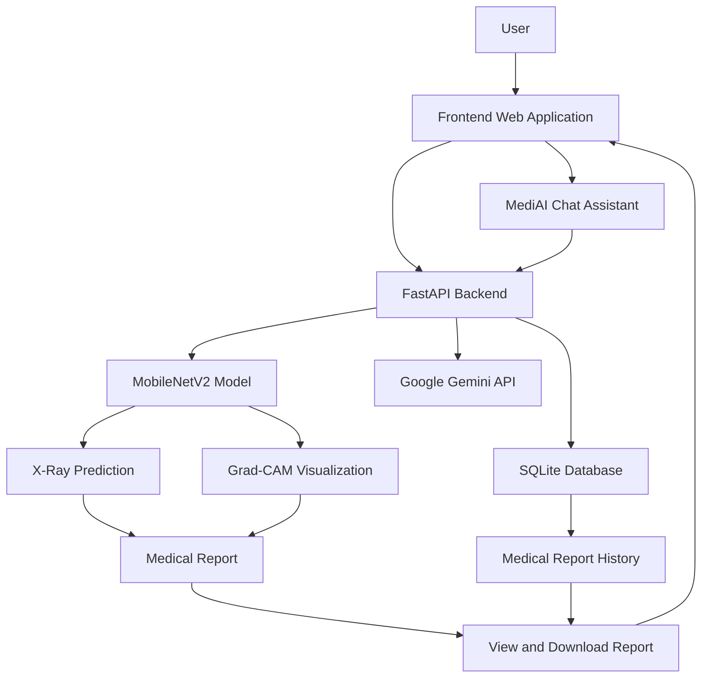

# AI Medical X-Ray Analysis

An AI-powered medical imaging application that combines deep learning, explainable AI, and generative AI to analyze chest X-ray images, visualize model predictions, and generate downloadable medical reports.

**Live Demo:** https://ai-medical-x-ray-analysis-2.onrender.com

## Overview

AI Medical X-Ray Analysis is a web-based application designed to make AI-assisted chest X-ray analysis interactive and accessible. It uses a trained MobileNetV2 deep learning model to generate predictions and Grad-CAM to visualize image regions that influence the model's output.

Users can interact with the MediAI chat assistant, review previous medical analyses, and download medical reports through an interactive dashboard.

## Key Features

- **AI-Based X-Ray Analysis:** Upload chest X-ray images and receive predictions from a trained deep learning model.
- **Grad-CAM Visualization:** Visualize image regions that influence the model's prediction.
- **AI Medical Chat Assistant:** Chat with MediAI, powered by the Google Gemini API, to ask medical-information questions.
- **Medical Report Generation:** Access reports containing the available analysis results and visualizations.
- **Downloadable Medical Reports:** Download generated medical reports for personal reference.
- **Medical Report History:** Review previously saved analysis records and access past reports.
- **User Authentication:** Register and log in to access user-specific features.
- **Interactive Dashboard:** Navigate between X-ray analysis, AI chat, report history, and other application features.
- **Cloud Deployment:** Access the application through its deployed frontend and backend.

## Technology Stack

| Component | Technologies |
|---|---|
| Frontend | HTML, CSS, JavaScript |
| Backend | Python, FastAPI |
| Deep Learning | TensorFlow, Keras, MobileNetV2 |
| Explainable AI | Grad-CAM |
| Generative AI | Google Gemini API |
| Database | SQLite |
| Authentication | JSON Web Tokens (JWT) |
| Deployment | Render, Docker |

## System Architecture

## How It Works

1. **Upload:** The user uploads a chest X-ray image through the web application.
2. **Preprocessing:** The backend prepares the image for the trained deep learning model.
3. **Prediction:** MobileNetV2 processes the image and generates a prediction.
4. **Visualization:** Grad-CAM highlights image regions that influence the model's output.
5. **Report:** The user views the available analysis results and can download the generated medical report.
6. **History:** Previous analysis records can be accessed through the medical report history.
7. **AI Chat:** The user interacts with MediAI for additional medical information.

## Deployment

| Component | Platform |
|---|---|
| Frontend | Render Static Site |
| Backend | Render Web Service using Docker |

- **Live Application:** https://ai-medical-x-ray-analysis-2.onrender.com
- **Backend Service:** https://ai-medical-x-ray-analysis-1.onrender.com

## Future Enhancements

- Support for additional medical imaging tasks.
- Improved model evaluation across diverse datasets.
- Enhanced explainability and report visualizations.
- Expanded AI assistant capabilities.

## Author

**Shivamani Rao**

- **GitHub:** https://github.com/shivamani2024

---

**Disclaimer:** This is an educational AI project. Model predictions and generated reports are not substitutes for professional medical diagnosis or advice.
