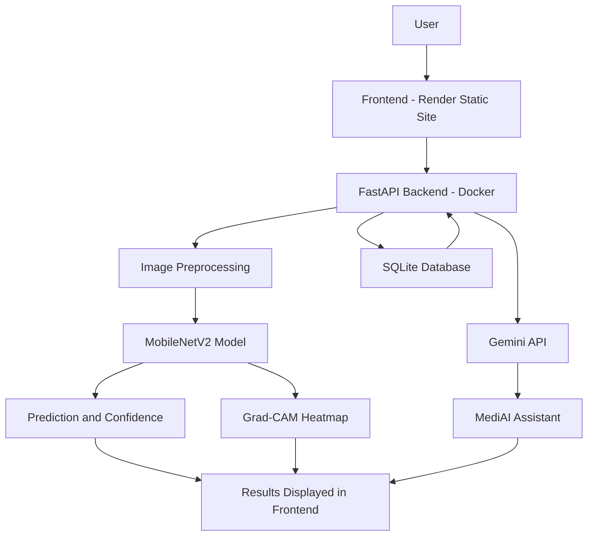

# 🩻 AI Medical X-Ray Analysis

### Deep Learning · Medical Image Analysis · Explainable AI · Generative AI

An AI-powered medical imaging web application that analyzes chest X-ray images using a trained deep-learning model, provides visual explanations through Grad-CAM, and offers an AI-powered medical information assistant.

<p align="center">
  <a href="https://ai-medical-x-ray-analysis-2.onrender.com"><strong>🌐 Live Demo</strong></a>
</p>

---

## 📌 Overview

**How can deep learning, explainable AI, and generative AI work together to make medical image analysis more accessible and understandable?**

AI Medical X-Ray Analysis explores this question through a web application that combines a trained MobileNetV2 model, a FastAPI backend, Grad-CAM visualization, and a Gemini-powered conversational assistant.

Users can upload chest X-ray images, obtain a model-generated prediction, review the associated confidence score, explore visual explanations of relevant image regions, and interact with MediAI for educational information about their results.

The application integrates a browser-based frontend, a REST API backend, a deep-learning inference pipeline, database functionality, and generative AI capabilities.

> **Medical Disclaimer:** This application is intended for educational and research purposes only. Its predictions and explanations are not medical diagnoses and must not replace professional medical evaluation.

## ✨ Key Features

- **Chest X-Ray Analysis:** Analyze uploaded chest X-ray images using a trained deep-learning model.
- **Deep Learning Inference:** Use a MobileNetV2-based model to generate predictions.
- **Confidence Score:** Display the model's prediction confidence.
- **Grad-CAM Explainability:** Generate heatmaps highlighting image regions contributing to the model's prediction.
- **MediAI Assistant:** Ask general medical-information questions using the Gemini API.
- **User Authentication:** Support registration, login, and token-based authentication.
- **Analysis History:** Retrieve previous analysis records associated with the authenticated user.
- **Interactive Dashboard:** View analysis results and related application functionality.
- **REST API:** Expose backend functionality through FastAPI.
- **Cloud Deployment:** Host the frontend and backend separately using Render Static Site and Docker Web Service.

## 🏗️ System Architecture

The application connects a web frontend to a FastAPI backend, which handles image preprocessing, model inference, result storage, Grad-CAM visualization, and AI-assisted conversations.



### 🔄 Application Workflow

1. **Image Upload:** The user uploads a chest X-ray image through the frontend.
2. **API Request:** The frontend sends the request to the FastAPI backend.
3. **Image Preprocessing:** The backend prepares the image for the model's expected input dimensions.
4. **Model Inference:** The trained MobileNetV2 model processes the image and generates a prediction.
5. **Explainability:** Grad-CAM produces a heatmap to visualize image regions contributing to the model's output.
6. **Result Storage:** Analysis information can be stored and retrieved through the application's database functionality.
7. **AI Assistance:** MediAI uses available analysis context to help answer relevant questions through the Gemini API.
8. **Result Presentation:** The frontend displays the available prediction, confidence information, visualization, and assistant responses.

## 🧠 AI and Machine Learning Components

### 1. MobileNetV2

The application uses a trained MobileNetV2-based deep-learning model for chest X-ray image classification.

MobileNetV2 is a convolutional neural network architecture designed for computationally efficient image feature extraction and classification.

The deployed model was verified to load with the following shapes:

- **Input shape:** `(None, 224, 224, 3)`
- **Output shape:** `(None, 1)`

The output represents a single model output; its interpretation depends on the model's training, output activation, and preprocessing configuration.

### 2. Grad-CAM — Explainable AI

Gradient-weighted Class Activation Mapping (Grad-CAM) helps visualize image regions that contribute to a model's prediction.

The deployed application uses the `Conv_1` layer for Grad-CAM visualization.

The generated heatmap is an interpretability aid. It does not prove that the prediction is clinically correct or that a highlighted region represents a confirmed medical finding.

### 3. MediAI — Generative AI Assistant

MediAI is a conversational assistant integrated into the application using the Gemini API.

Its functionality includes:

- Answering general medical-information questions.
- Explaining prediction confidence in accessible language.
- Helping users understand available analysis information.
- Suggesting relevant follow-up questions.
- Providing educational information about symptoms and discussions with healthcare professionals.

AI-generated responses may be incomplete or incorrect and should not be treated as professional medical advice.

## 🛠️ Technology Stack

| Component | Technologies |
|---|---|
| Frontend | HTML, CSS, JavaScript |
| Backend | Python, FastAPI |
| Deep Learning | TensorFlow, Keras |
| Model Architecture | MobileNetV2 |
| Explainable AI | Grad-CAM |
| Generative AI | Gemini API |
| Authentication | JWT-based authentication |
| Database | SQLite |
| API Server | Uvicorn |
| Model Format | Keras model format |
| Containerization | Docker |
| Version Control | Git, GitHub |
| Deployment | Render Static Site and Docker Web Service |

## 📂 Project Structure

```text
AI-Medical-X-Ray-Analysis/
│
├── backend/
│   ├── main.py
│   ├── auth.py
│   └── ...
│
├── frontend/
│   ├── index.html
│   ├── dashboard.js
│   ├── script.js
│   ├── ai-assistant.js
│   └── ...
│
├── models/
│   └── [trained Keras model]
│
├── Dockerfile
├── requirements.txt
├── .env.example
└── README.md
```

*Note: This is a high-level project structure. The exact model filename and additional files depend on the current repository contents.*

## 🌐 Live Deployment

The application is deployed using separate frontend and backend services.

| Service | Purpose | URL |
|---|---|---|
| Frontend | User interface | [Open Live Application](https://ai-medical-x-ray-analysis-2.onrender.com) |
| Backend | FastAPI application | [Backend API](https://ai-medical-x-ray-analysis-1.onrender.com) |

### Deployment Architecture

- **Frontend:** Render Static Site serving the HTML, CSS, and JavaScript files.
- **Backend:** Render Docker Web Service running FastAPI and the trained deep-learning model.
- **AI Assistant:** Gemini API integration configured through backend environment variables.
- **Database:** SQLite for application data, subject to the deployed service's storage configuration.

## ⚙️ Local Setup and Installation

### Prerequisites

- Python 3.12 or another version compatible with the project's dependencies.
- Git.
- Visual Studio Code or another code editor.
- A Gemini API key if you want to use the AI assistant.
- The trained model file required by the backend.

### 1. Clone the Repository

```bash
git clone https://github.com/shivamani2024/AI-Medical-X-Ray-Analysis.git
cd AI-Medical-X-Ray-Analysis
```

### 2. Create a Virtual Environment

**Windows:**

```bash
python -m venv .venv
.venv\Scripts\activate
```

**Linux or macOS:**

```bash
python3 -m venv .venv
source .venv/bin/activate
```

### 3. Install Dependencies

```bash
pip install -r requirements.txt
```

If installation fails, verify that your Python version and package versions are compatible with the requirements file.

### 4. Configure Environment Variables

Create a local `.env` file using `.env.example` as a reference. Configure the variables expected by your backend.

Example:

```env
GEMINI_API_KEY=your_gemini_api_key
JWT_SECRET_KEY=your_secure_random_secret
```

Use actual secret values only in your local environment or deployment settings. Never commit secret values to GitHub.

### 5. Start the Backend

From the repository root, run:

```bash
uvicorn backend.main:app --reload
```

The local backend should be available at:

```text
http://127.0.0.1:8000
```

### 6. Start the Frontend

1. Open the `frontend` directory in Visual Studio Code.
2. Start the website using Live Server or another local static file server.
3. Ensure the frontend API base URL points to the intended backend.
4. For local development, the API URL is typically `http://127.0.0.1:8000`.
5. For the deployed application, use the deployed Render backend URL.

If the frontend and backend use different origins, configure the backend's CORS policy to allow the appropriate frontend origin.

## 🔐 Security Considerations

- Keep API keys and JWT secrets out of frontend JavaScript.
- Store sensitive configuration in environment variables.
- Use HTTPS for deployed application traffic.
- Protect authenticated endpoints with appropriate token validation.
- Validate uploaded files and enforce suitable upload size and content restrictions.
- Configure CORS for trusted frontend origins.
- Avoid storing unnecessary sensitive medical information.
- Configure persistent storage and database backups where required.

## 🧪 Testing and Verification

Use the following checklist when validating the application:

- [ ] Frontend loads correctly.
- [ ] Registration and login work.
- [ ] Authenticated API requests succeed.
- [ ] X-ray upload and model inference work.
- [ ] Prediction results and confidence information are displayed.
- [ ] Grad-CAM visualization is generated successfully.
- [ ] Analysis history loads for the authenticated user.
- [ ] MediAI responds when the Gemini API is available.
- [ ] Invalid requests and expired authentication tokens are handled appropriately.
- [ ] Backend logs do not expose credentials or sensitive information.

The application has been deployed to Render, and the main website functionality has been manually tested.

## ⚠️ Limitations

- Predictions depend on the training data, preprocessing pipeline, and model quality.
- A confidence score is not the same as clinical certainty.
- Grad-CAM visualizations are explanatory aids, not proof of clinical reasoning.
- Generative AI responses can be incomplete or incorrect.
- Real-world medical use requires appropriate clinical validation, privacy safeguards, and regulatory assessment.
- Service availability and response time depend on deployment resources and third-party API availability.

## 🔮 Future Improvements

- Add a comprehensive automated test suite.
- Improve model evaluation with independent validation data and suitable clinical metrics.
- Add model performance monitoring with privacy safeguards.
- Introduce asynchronous inference for larger workloads.
- Improve observability through structured logging and error tracking.
- Add more robust input validation and deployment health checks.
- Expand accessibility and responsive UI testing.
- Investigate model calibration and uncertainty estimation.

## 👨‍💻 Author

**Shivamani Rao**

B.Tech — Computer Science and Engineering, Artificial Intelligence and Machine Learning

- **GitHub:** [shivamani2024](https://github.com/shivamani2024)
- **Live Application:** [AI Medical X-Ray Analysis](https://ai-medical-x-ray-analysis-2.onrender.com)

## 📄 License

No license has been specified in this README. Add a `LICENSE` file and update this section if you intend to distribute the project under an open-source license.

---

<p align="center">
  <strong>Built with Deep Learning, Explainable AI, and Generative AI.</strong>
</p>

<p align="center">
  <sub>For educational and research purposes only — not a substitute for professional medical diagnosis.</sub>
</p>
